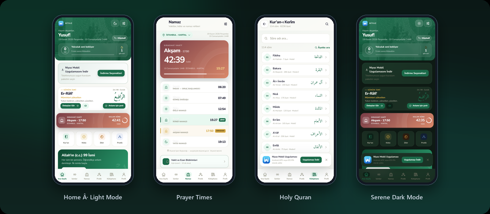

# 🌿 Niyaz
### Offline-First Prayer Times, Quran, Qibla &amp; Daily Companion

*A serene, ad-free, 100% offline-capable Islamic companion for Android, iOS, and Web.*

🇬🇧 **English** · 🇹🇷 [**Türkçe**](./README.tr.md)

 

&nbsp;&nbsp;&nbsp;

  

[🤖 Download Android (.apk)](https://github.com/strangerforge/Niyaz/releases/latest/download/niyaz.apk) &nbsp;·&nbsp; [🍏 Download iOS (.ipa)](https://github.com/strangerforge/Niyaz/releases/latest/download/niyaz.ipa) &nbsp;·&nbsp; [🌐 Live Web Preview](https://niyaz-app.vercel.app)

 

---

> **Repository Scope:** This repository is the official **release, documentation, and issue tracker hub** for **Niyaz** (free to download and use; source code is maintained privately). Please open an [Issue](https://github.com/strangerforge/Niyaz/issues) for bug reports, device compatibility feedback, or feature requests.

---

## ✨ What is Niyaz?

**Niyaz** is a calm, distraction-free mobile companion built to help you keep track of daily prayers, Quran reading, Qibla direction, and dhikr without clutter.

It contains **zero ads, zero tracking, and zero unnecessary prompts**. Built with an **Offline-First** architecture, it works reliably even with no internet connection—on flights, in the mountains, or while traveling.

---

## 🌟 Key Features

| Feature | Description |
| :--- | :--- |
| 🕌 **Prayer Times &amp; Live Notifications** | Location-aware daily prayer schedule, live countdown timer to the next prayer, and on-time adhan notifications. *(Not officially affiliated with Diyanet.)* |
| 🧭 **Live Qibla Compass** | High-precision 3D Qibla compass powered by your device's compass and geolocation sensors. |
| 📖 **Holy Quran** | Original Arabic script, Turkish translation, audio recitation, surah &amp; juz index, search, and automatic last-read bookmarking. |
| 📿 **Smart Tasbih &amp; Dhikr Counter** | Haptic feedback, optional audio click, post-prayer tasbihat, and custom daily targets. |
| ✨ **Asma al-Husna** | The 99 names of Allah with meanings, virtues, and suggested dhikr counts. |
| 🤲 **Duas &amp; Supplications** | Curated Quranic prayers, authentic Prophetic supplications, and daily duas. |
| 🌙 **Light &amp; Dark Themes** | Soft organic light theme for daytime clarity and high-contrast dark mode for night reading. |
| ⚡ **Zero Ads, 100% Privacy** | No analytics, no user profiling, no background trackers, and no ads—ever. |

---

## 📲 Download &amp; Installation

> ⚠️ **Important Note:** To receive reliable background adhan and prayer-time alerts while the screen is locked, install the native **Android (.apk)** or **iOS (.ipa)** package. *(Mobile browsers restrict background alarms in web mode).*

### 1. 🤖 Android (`.apk`) — *Recommended*
1. Download the latest release package: [**niyaz.apk**](https://github.com/strangerforge/Niyaz/releases/latest/download/niyaz.apk)
2. Tap the downloaded file.
3. If prompted, allow *"Install from unknown sources"*.
4. Tap **Install** to finish setup.

### 2. 🍏 iOS (`.ipa`)
1. Download the latest package: [**niyaz.ipa**](https://github.com/strangerforge/Niyaz/releases/latest/download/niyaz.ipa)
2. Sideload onto your iPhone/iPad using **AltStore**, **SideStore**, or **Sideloadly**.

### 3. 🌐 Web Preview (PWA)
Try the interface instantly in any browser before installing: 👉 **[niyaz-app.vercel.app](https://niyaz-app.vercel.app)**

---

## 📄 Feedback &amp; Terms

- **Bug Reports &amp; Suggestions:** [Issues](https://github.com/strangerforge/Niyaz/issues)
- **Security:** See [SECURITY.md](./SECURITY.md)
- **Terms:** **Niyaz** is free to download and use without ads. Application source code is closed-source; all rights reserved by **@strangerforge**.

Built with care by <a href="https://github.com/strangerforge"><strong>@strangerforge</strong></a>

