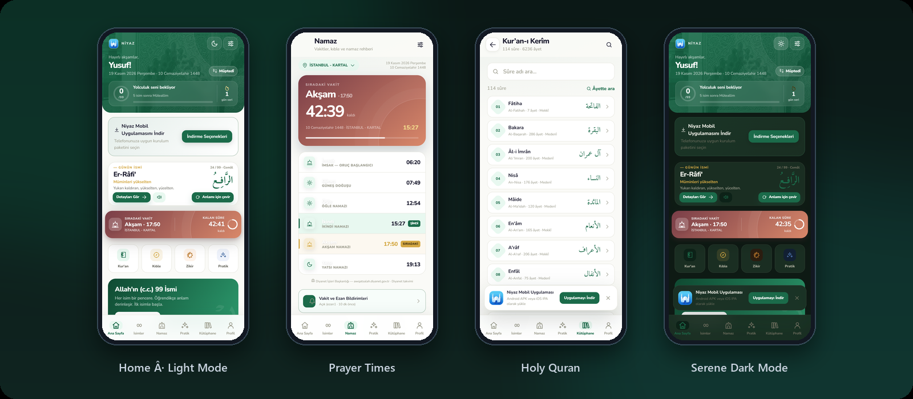

# 🌿 Niyaz
### Kur'an-ı Kerîm, Namaz Vakitleri, Dualar ve Zikir

*Huzurlu, reklamsız ve %100 çevrimdışı çalışan modern manevi yol arkadaşınız.*

🇬🇧 [**English**](./README.md) · 🇹🇷 **Türkçe**

 

&nbsp;&nbsp;&nbsp;

  

[🤖 Android İndir (.apk)](https://github.com/strangerforge/Niyaz/releases/latest/download/niyaz.apk) &nbsp;·&nbsp; [🍏 iOS İndir (.ipa)](https://github.com/strangerforge/Niyaz/releases/latest/download/niyaz.ipa) &nbsp;·&nbsp; [🌐 Web Önizleme](https://niyaz-app.vercel.app)

 

---

> **Depo Kapsamı:** Bu depo, **Niyaz** uygulamasının resmi **sürüm dağıtım, dokümantasyon ve geri bildirim (Issue Tracker)** merkezidir. Uygulama ücretsiz ve reklamsız sunulmakta olup kaynak kodu kapalı tutulmaktadır. Hata bildirimleri ve önerileriniz için [Issues](https://github.com/strangerforge/Niyaz/issues) sekmesini kullanabilirsiniz.

---

## ✨ Niyaz Nedir?

**Niyaz**, modern yaşamın koşturmacasında ibadetlerinizi düzenli, sade ve huzurlu bir şekilde yerine getirmeniz için tasarlanmış bir mobil uygulamadır.

Hiçbir dikkat dağıtıcı reklam, gereksiz bildirim veya karmaşık menü barındırmaz. **"Offline-First"** (Önce Çevrimdışı) mimarisi sayesinde internet bağlantınız olmasa dahi dağda, yolculukta veya uçakta kesintisiz çalışır.

---

## 🌟 Öne Çıkan Özellikler

| Özellik | Açıklama |
| :--- | :--- |
| 🕌 **Namaz Vakitleri &amp; Canlı Bildirimler** | Konumunuza göre uyumlu vakitler, ezana kalan süreyi gösteren simetrik canlı sayaç ve vaktinde çalan ezan bildirimleri. *(Diyanet İşleri Başkanlığı ile resmi bir bağı yoktur.)* |
| 🧭 **Canlı Kıble Pusulası** | Telefonunuzun pusula ve konum sensörlerini kullanarak Kabe yönünü hassasiyetle gösteren 3D pusula. |
| 📖 **Kur'an-ı Kerîm** | Arapça orijinal hat, Türkçe meâl, sesli tilâvet, sure ve cüz fihristi, arama ve son kalınan yeri hatırlama. |
| 📿 **Akıllı Zikirmatik &amp; Tesbihat** | Dokunsal geri bildirim (haptic titreşim), sesli sayaç, namaz tesbihatı ve özel zikir hedefleri belirleme. |
| ✨ **Esmaü'l-Hüsna** | Allah'ın 99 güzel ismi, Türkçe anlamları, faziletleri ve zikir adetleri. |
| 🤲 **Dualar &amp; Niyazlar** | Kur'an'dan dualar, Peygamber Efendimiz'in (s.a.v.) sahih duaları ve günlük yaşam niyazları. |
| 🌙 **Gece / Gündüz Teması** | Göz yormayan organik açık tema ve gece okumaları için özel kontrastlı koyu tema. |
| ⚡ **Sıfır Reklam, %100 Gizlilik** | Hiçbir kullanıcı verisi toplanmaz, reklam gösterilmez, arka planda izleme yapılmaz. |

---

## 📲 Kurulum ve İndirme Seçenekleri

> ⚠️ **Önemli Hatırlatma:** Ezan ve namaz vakti bildirimlerinin arka planda ve ekran kilitliyken zamanında çalabilmesi için uygulamanın **Android (.apk)** veya **iOS (.ipa)** mobil paketi olarak kurulması gerekmektedir. *(Tarayıcılar arka plan bildirimlerine kısıtlama getirdiği için web kurulumunda bildirimler çalışmaz).*

### 1. 🤖 Android (`.apk` Kurulumu) — *Önerilen*
1. Doğrudan son sürüm paketini indirin: [**niyaz.apk İndir**](https://github.com/strangerforge/Niyaz/releases/latest/download/niyaz.apk)
2. İndirilen dosyaya dokunun.
3. Telefonunuz *"Bilinmeyen kaynaklardan uygulama yükleme"* izni isterse onaylayın.
4. *"Yükle"* butonuna basarak kurulumu tamamlayın.

### 2. 🍏 iOS (`.ipa` Kurulumu)
1. Son sürüm paketini indirin: [**niyaz.ipa İndir**](https://github.com/strangerforge/Niyaz/releases/latest/download/niyaz.ipa)
2. **AltStore**, **SideStore** veya **Sideloadly** gibi araçlarla iPhone/iPad'inize yükleyin.

### 3. 🌐 Web Önizleme (Tarayıcı)
Uygulamayı indirmeden önce arayüzünü hızlıca denemek için: 👉 **[niyaz-app.vercel.app](https://niyaz-app.vercel.app)**

---

## 📄 Geri Bildirim &amp; Kullanım Koşulları

- **Hata Bildirimi ve Öneriler:** [Issues](https://github.com/strangerforge/Niyaz/issues)
- **Güvenlik Bildirimi:** [SECURITY.md](./SECURITY.md)
- **Kullanım Koşulları:** **Niyaz** tamamen ücretsiz ve reklamsız olarak sunulmaktadır. Uygulamanın kaynak kodu kapalıdır; tüm hakları **@strangerforge**'a aittir.

Geliştirici: <a href="https://github.com/strangerforge"><strong>@strangerforge</strong></a> • Huzurla ve dua ile kullanınız.

